## 1. Identificar los objetivos del sistema

### 1.1 Objetivo general

Gestionar de forma digital la guardería de mascotas de la Clínica Veterinaria Patitas Felices, desde el ingreso hasta la entrega de cada mascota, con cuidados personalizados, alertas oportunas y reportes para la administración.

### 1.2 Objetivos específicos

- Registrar propietarios, mascotas y estancias, y asignar a cada mascota un código único.
- Entregar cada mascota solo a su propietario o a una persona autorizada, verificando la identidad de la persona y de la mascota.
- Controlar las dietas y los medicamentos con alertas automáticas y con constancia de su cumplimiento.
- Programar y registrar paseos, juegos y baños según las necesidades y restricciones de cada mascota.
- Generar reportes de ocupación, de frecuencia de uso por cliente y de satisfacción de los clientes.
- Controlar el acceso a la información según el rol de cada empleado.

## 2. Identificar y clasificar los requerimientos

### 2.1 Requerimientos funcionales

- Registrar y actualizar propietarios con nombre, documento, teléfono y autorización para el tratamiento de sus datos.
- Registrar mascotas vinculadas a su propietario, con especie, raza, señas particulares y fotografía, y asignar a cada una un código único.
- Registrar el ingreso con fecha, tipo de estancia (por día o por varios días), salida prevista y personas autorizadas para retirar la mascota.
- Impedir el ingreso si la mascota ya tiene una estancia activa o si no hay cupos.
- Registrar el plan de cuidado de cada mascota: dieta, medicamentos con dosis y horario, y restricciones de actividad.
- Generar alertas automáticas de medicamentos y dietas especiales según los horarios del plan de cuidado.
- Registrar la atención de cada alerta con el responsable y la hora.
- Programar paseos, juegos y baños por mascota, validando sus restricciones de actividad.
- Mostrar la agenda diaria y registrar cada actividad como realizada o cancelada.
- Verificar en la entrega que quien retira sea el propietario o una persona autorizada, y que el código de la mascota corresponda a la estancia, mostrando su fotografía.
- Registrar los intentos de retiro no autorizados.
- Cerrar la estancia, liberar el cupo y habilitar la encuesta de satisfacción.
- Registrar la respuesta de la encuesta: calificación de 1 a 5 y comentario.
- Generar, por periodo, los reportes de ocupación frente a la capacidad, de frecuencia de uso por cliente y de satisfacción.
- Gestionar los usuarios del personal y asignarles un rol.
- Configurar la capacidad máxima de la guardería.
- Autenticar al usuario con usuario y contraseña antes de cualquier acción del personal.

### 2.2 Requerimientos no funcionales

| Tipo           | Requerimiento                                                                                                             |
| -------------- | ------------------------------------------------------------------------------------------------------------------------- |
| Seguridad      | Las contraseñas se guardan cifradas, cada rol solo ve sus funciones y la sesión se cierra tras 15 minutos de inactividad. |
| Legal          | Los datos personales de los clientes se tratan según la Ley 1581 de 2012, con autorización del titular.                   |
| Usabilidad     | Un ingreso se registra en máximo 3 minutos, y las funciones principales están a máximo 5 clics desde el inicio.           |
| Rendimiento    | Las búsquedas responden en menos de 2 segundos y los reportes de un año en menos de 5 segundos.                           |
| Disponibilidad | El sistema está disponible el 99 % del horario de operación de la guardería.                                              |
| Oportunidad    | Cada alerta aparece en menos de 1 minuto desde su hora programada.                                                        |
| Auditabilidad  | Los registros de ingresos, entregas y atención de alertas no se pueden modificar ni eliminar.                             |

### 2.3 Requerimientos de usuario

| Usuario       | Necesita                                                                            |
| ------------- | ----------------------------------------------------------------------------------- |
| Recepcionista | Registrar a los propietarios y a sus mascotas.                                      |
| Recepcionista | Registrar el ingreso de una mascota a la guardería.                                 |
| Recepcionista | Entregar la mascota a su propietario o a una persona autorizada.                    |
| Veterinario   | Registrar la dieta, la medicación y las restricciones de actividad de cada mascota. |
| Cuidador      | Recibir y atender los avisos de medicamentos y dietas especiales.                   |
| Cuidador      | Programar paseos, juegos y baños para cada mascota.                                 |
| Cuidador      | Registrar las actividades realizadas.                                               |
| Cliente       | Calificar el servicio al recoger la mascota.                                        |
| Administrador | Consultar la ocupación, la frecuencia de uso por cliente y la satisfacción.         |
| Administrador | Administrar los usuarios del personal y sus roles.                                  |
| Administrador | Definir la capacidad de la guardería.                                               |

## 3. Elaborar el diagrama de actividades

### 3.1 Seleccionar una funcionalidad del sistema

La funcionalidad seleccionada es Entregar mascota.

### 3.2 Representarla mediante un diagrama de actividades

## 4. Elaborar el diagrama de casos de uso

### 4.1 Representar el sistema completo mediante un diagrama de casos de uso

https://www.figma.com/proto/QrbZxTJ08zarIsTeol9RK1/TS-103004-Patitas-Felices?node-id=26-83&p=f&t=k5OhJwz3NcOlVvdE-1&scaling=min-zoom&content-scaling=fixed&page-id=13%3A4&starting-point-node-id=26%3A83&show-proto-sidebar=1
